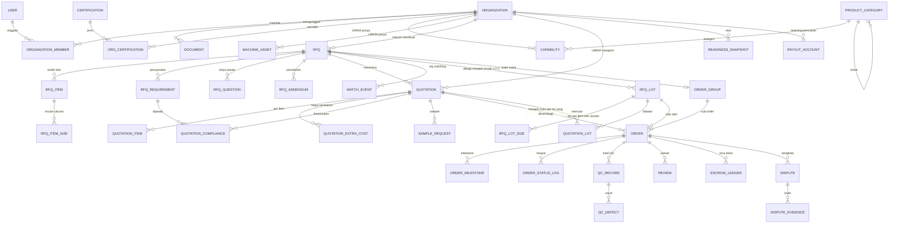

<!-- Bagian dari spec RantaiNaik v3. Sumber kebenaran. Perubahan wajib dicatat di docs/DECISIONS.md -->

## 10. Model data (tingkat konseptual)

**Entitas utama dan atribut kunci**
| Entitas | Atribut kunci |
|---|---|
| `user` | id, email, password_hash, role (INDUSTRY/UMKM/ADMIN), status |
| `organization` | id, type, nama, kota, provinsi, lat/long, status verifikasi, jenis (korporasi/brand/konveksi) |
| `document` | id, org_id, jenis, file_url, status, alasan_tolak, berlaku_hingga |
| `certification` | id, nama (uji lab kain, OEKO-TEX, dan lainnya) |
| `capability` | org_id, category_id, layanan[], bahan[], dekorasi[], kapasitas_bulanan, MOQ, lead_time_hari, area_layanan |
| `machine_asset` | org_id, jenis (jahit lurus, obras, bordir, dll.), jumlah |
| `rfq` | id, industry_org_id, judul, jenis_kebutuhan, visibilitas, tenggat_qa, tenggat_penawaran, target_kirim, lokasi_kirim, kirim_bertahap, perlu_sampel, penanggung_biaya_sampel, termin_pembayaran, anggaran_indikatif, bobot_evaluasi (JSON), **mode_alokasi (TUNGGAL/LOT), maks_lot_per_umkm, aturan_konsistensi_bahan, standar_acuan (JSON: golden_sample, toleransi_dimensi, acuan_warna, aql), kebijakan_harga_lot, denda_terlambat (opsional)**, status |
| `rfq_item` | rfq_id, nama, category_id, bahan, gsm_min/max, warna, bahan_disediakan_pembeli, dekorasi, lampiran, catatan_konstruksi, label_packing, toleransi_jumlah, standar_mutu |
| `rfq_item_size` | rfq_item_id, ukuran, qty |
| `rfq_requirement` | rfq_id, tipe (bahan/gsm/warna/dekorasi/uji/jadwal/jumlah/packing), nilai, wajib |
| `rfq_question` | rfq_id, org_id, pertanyaan, jawaban, dijawab_pada |
| `rfq_addendum` | rfq_id, nomor, ringkasan_perubahan, dibuat_pada |
| `quotation` | id, rfq_id, umkm_org_id, versi, berlaku_hingga, include_ppn, lead_time, kapasitas_alokasi, tanggal_kirim_dapat_dipenuhi, termin_diminta, ongkir_ditanggung, kebijakan_reject, status |
| `quotation_item` | quotation_id, rfq_item_id, harga_satuan, bahan_ditawarkan, status_bahan (sesuai/alternatif), dekorasi_ditawarkan |
| `quotation_extra_cost` | quotation_id, nama, nominal, satuan |
| `quotation_compliance` | quotation_id, requirement_id, jawaban (SESUAI/ALTERNATIF/TIDAK_SESUAI), catatan |
| `sample_request` | quotation_id, diminta_pada, tenggat, resi, status, skor_bahan/jahitan/ukuran/finishing, keputusan, catatan |
| `order` | id, quotation_id, rfq_lot_id (null bila TUNGGAL), order_group_id (null bila TUNGGAL), snapshot, nilai, status, escrow_status, tanggal_target, tanggal_aktual |
| `order_milestone` | order_id, tahap, tanggal, foto |
| `qc_record` | order_id, hasil, qty_diterima_per_ukuran, catatan |
| `qc_defect` | qc_id, jenis_cacat, jumlah |
| `review` | order_id, dari_org, ke_org, rating, aspek, komentar |
| `readiness_snapshot` | org_id, skor_total, skor_per_komponen (JSON), tier, dihitung_pada |
| `recommendation_rule`, `scoring_config` | aturan rekomendasi, bobot dan ambang |
| `match_event` | rfq_id, org_id, skor, rincian, hasil_akhir *(data latih Fase 2)* |
| `notification`, `audit_log` | notifikasi dan jejak audit |
| `rfq_lot` | id, rfq_id, nama (A-D), qty_total, tanggal_kirim, status (OPEN/WON/EMPTY) |
| `rfq_lot_size` | rfq_lot_id, rfq_item_id, ukuran, qty |
| `quotation_lot` | quotation_id, rfq_lot_id, harga_satuan (per item), lead_time, kapasitas_alokasi, sumber_bahan, bersedia_harga_disamakan, status (SUBMITTED/SHORTLISTED/WON/BACKUP/REJECTED), skor |
| `order_group` | id, rfq_id, status (turunan dari sub-order) |
| `escrow_ledger` | id, order_id, tipe (FUND/HOLD/RELEASE/REFUND/FEE/ADJUST), jumlah, status, referensi (milestone/QC/dispute), idempotency_key, dibuat_oleh, dibuat_pada *(append-only)* |
| `payout_account` | org_id, bank, nomor_rekening (terenkripsi), nama_pemilik, status verifikasi |
| `dispute` | id, order_id, dibuka_oleh, alasan, tuntutan, status, keputusan (RELEASE_FULL/REFUND_FULL/SPLIT/REWORK_FIRST), rincian_dana, alasan_keputusan, diputus_oleh, diputus_pada |
| `dispute_evidence` | dispute_id, org_id, jenis, file_url atau teks, dibuat_pada |
| `platform_config` | komisi_persen, batas_lot (min, maks), qty_min_lot, jendela_waktu (pendanaan, konfirmasi otomatis, tenggang UMKM tidak aktif, klaim), matriks_kompensasi |
| `capacity_commitment` *(turunan)* | org_id, periode, kapasitas_total, terpakai (dari penawaran aktif dan order berjalan) |
| `buyer_reputation` *(turunan)* | org_id, pembatalan_sepihak, ketepatan_pendanaan, jumlah_sengketa |

---
